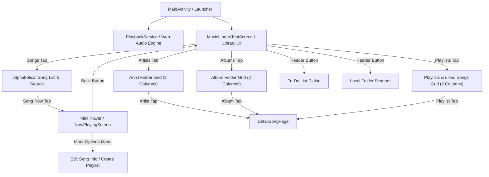

# 🎵 SoundWave - Modern Full-Stack Music Web App

A modern, full-stack music player and library web application built with **React.js**, **Node.js (Express)**, and **Web Audio API** designed with the **"White Devil's Music"** light aesthetic.

---

## ⚡ Automatic Local Audio Discovery (MP3 & M4A)

You **do not need to manually copy or import songs**. The app automatically finds your local audio files:

### 1. Zero Random Songs (100% Real Local Music)
- All random mock and seed sample tracks have been completely removed.
- The library displays **only real audio files located on your computer**.

### 2. Automated Search Locations
On startup and on every library refresh, the backend automatically scans:
- **Downloads Folder**: `C:\Users\<Username>\Downloads`
- **Music Folder**: `C:\Users\<Username>\Music`
- **OneDrive Music**: `C:\Users\<Username>\OneDrive\Music`
- **App Songs Storage**: `d:\Music\songs`

Any `.mp3`, `.m4a`, `.wav`, `.flac`, `.ogg`, or `.aac` files found are automatically discovered, metadata is extracted (title, artist, album, duration, embedded cover art), and they are immediately available for playback.

### 3. Real-Time Download Watcher
- The backend actively monitors your **Downloads** and **Music** folders.
- Whenever you download a new song, it is **automatically detected and added to your library** in real time without needing a restart.

---

## 🏛️ Architecture & Navigation Workflow



---

## 🚀 Running the App

From `d:\Music`:
```powershell
npm run dev
```

- **Backend API**: `http://localhost:5000`
- **Frontend App**: `http://localhost:3000`
